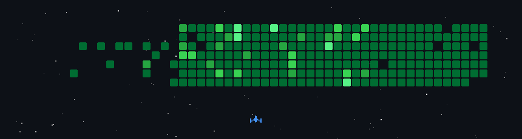

  

  

  
  
  
  
  

<!-- Retro Game Section -->

  

---

### 👨‍💻 Sobre Mim

Olá! Sou o **Alexandre Souza**, desenvolvedor Full Stack com atuação prática em projetos corporativos e foco em código limpo, arquitetura escalável e integração com Inteligência Artificial:

- 🎓 Cursando **Bacharelado em Ciência da Computação** na Faculdade Impacta (Previsão: 06/2028).
- 💼 Atuei como **Estagiário Desenvolvedor Full Stack**, desenvolvendo e mantendo aplicações com **React**, **TypeScript**, **NestJS** e **APIs REST**.
- 🛠️ Experiência em todo o ciclo técnico: criação e ajuste de componentes, validações, fluxos de frontend, construção de endpoints, serviços e integração com banco de dados.
- 🤖 Automação e Inteligência Artificial: criação de fluxos no **n8n**, chatbots contextuais com LLMs e **RAG Local** (LangChain, FAISS, Ollama).
- 🌐 **Idiomas:** Português (Nativo) · Inglês (Avançado) · Espanhol (Avançado).
- 📍 **Localização:** São Paulo - SP, Brasil.

---

### 🛠️ Tecnologias & Habilidades

  

 

| Categoria | Tecnologias & Ferramentas |
| :--- | :--- |
| **Frontend** | React, TypeScript, JavaScript (ES6+), HTML5, CSS3, Tailwind CSS |
| **Backend & APIs** | NestJS, Node.js, C#, .NET, APIs RESTful, JSON, Regras de Negócio e Endpoints |
| **Bancos de Dados** | SQL, PostgreSQL, Integração e Modelagem |
| **IA & Automação** | n8n, LangChain, FAISS, Ollama, RAG Local, Chatbots Generativos |
| **Qualidade & DevOps** | Git, GitHub, VS Code, Postman, Testes Unitários com Jest |

---

### 🚀 Projetos em Destaque

| Projeto | Descrição | Tecnologias | Acesso |
| :--- | :--- | :--- | :---: |
| 🍔 **App de Delivery** | Solução full stack completa: autenticação, catálogo de itens, checkout, pedidos e painel administrativo com automações. | `FlutterFlow` `Xano` `SQL` `REST APIs` `n8n` | [Ver Repositório](https://github.com/alexleonec6/Projeto-App-Delivery) |
| 🧠 **Mini-lum.IA** | Assistente RAG Local para consulta inteligente e contextualizada sobre documentos locais, com privacidade total. | `Python` `LangChain` `FAISS` `Ollama` `Streamlit` | [Ver Repositório](https://github.com/alexleonec6/Mini_lum.IA-sbk) |
| ⚡ **Automações com IA** | Chatbot inteligente e fluxos automatizados integrando IA Generativa, mensageria (Telegram) e APIs de serviços. | `n8n` `Python` `Telegram API` `Generative AI` | [Ver Repositório](https://github.com/alexleonec6/Automacoes-com-IA) |

---

### 📊 Estatísticas & Gráficos

  
  

  

<!-- Pac-Man Contribution Graph -->
<h3 align="center">🕹️ Pac-Man Contribution Graph</h3>

  <picture>
    <source media="(prefers-color-scheme: dark)" srcset="assets/pacman-contribution-graph-dark.svg">
    <source media="(prefers-color-scheme: light)" srcset="assets/pacman-contribution-graph.svg">
    
  </picture>

---

  

